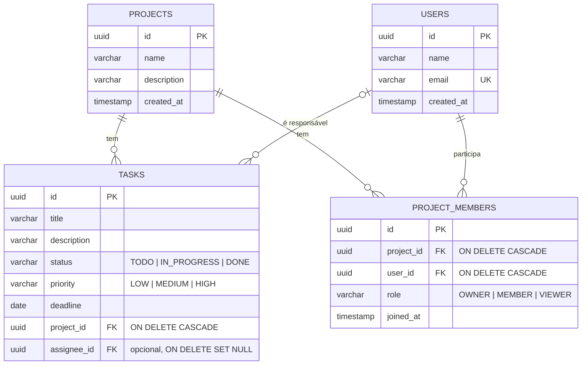

# TaskHub

API REST de gestão de tarefas para equipes: projetos, tarefas, usuários e membros de projeto.
Construída com Spring Boot e PostgreSQL, com schema versionado por Flyway, listagem paginada com filtros
combinados e erros padronizados no formato `ProblemDetail` (RFC 9457).

## Stack

- Java 21 e Spring Boot 4.1 (Web MVC, Data JPA, Validation)
- PostgreSQL 17 (via Docker Compose) e Flyway
- MapStruct e Lombok
- springdoc-openapi (Swagger UI)
- JUnit 5, Mockito, AssertJ, MockMvc, Testcontainers e JaCoCo

## Como rodar

Pré-requisitos: JDK 21 e Docker.

```bash
# 1. Variáveis de ambiente (o .env não é versionado)
cp .env.example .env          # preencha usuário e senha do banco

# 2. Banco de dados
docker compose up -d          # PostgreSQL na porta 5433

# 3. API (o Flyway aplica as migrations na subida)
./mvnw spring-boot:run
```

- Swagger UI: http://localhost:8080/swagger-ui.html
- Para recriar o banco do zero: `docker compose down -v && docker compose up -d`

## Endpoints

### Projetos

| Método | Rota | Descrição |
|---|---|---|
| `POST` | `/projects` | Cria um projeto (201 + `Location`) |
| `GET` | `/projects` | Lista projetos paginados (`page`, `size`, `sort`; padrão: 20 por página, ordenados por nome) |
| `GET` | `/projects/{id}` | Busca um projeto |
| `PUT` | `/projects/{id}` | Substitui os dados do projeto |
| `DELETE` | `/projects/{id}` | Remove o projeto e as tarefas dele (204) |

### Tarefas

| Método | Rota | Descrição |
|---|---|---|
| `POST` | `/projects/{projectId}/tasks` | Cria uma tarefa no projeto (nasce `TODO`; `assigneeId` opcional) |
| `GET` | `/projects/{projectId}/tasks` | Lista as tarefas do projeto, paginadas e filtradas |
| `PATCH` | `/tasks/{id}/status` | Altera o status da tarefa |

Parâmetros da listagem de tarefas (todos opcionais e combináveis entre si):

| Parâmetro | Exemplo | Efeito |
|---|---|---|
| `status` | `TODO`, `IN_PROGRESS`, `DONE` | Filtra por status |
| `priority` | `LOW`, `MEDIUM`, `HIGH` | Filtra por prioridade |
| `assigneeId` | UUID de um usuário | Filtra por responsável |
| `page`, `size` | `page=0&size=10` | Paginação (padrão: 20 por página, máximo 100) |
| `sort` | `sort=title,desc` | Ordenação (padrão: `deadline`) |

```http
GET /projects/{projectId}/tasks?status=TODO&priority=HIGH&assigneeId={userId}&page=0&size=10&sort=title,desc
```

A resposta paginada traz o conteúdo e os metadados:

```json
{
  "content": [ { "id": "...", "title": "...", "status": "TODO", "assigneeId": "...", "assigneeName": "..." } ],
  "page": { "size": 10, "number": 0, "totalElements": 42, "totalPages": 5 }
}
```

### Usuários e membros

| Método | Rota | Descrição |
|---|---|---|
| `POST` | `/users` | Cria um usuário (201 + `Location`; e-mail único, normalizado para minúsculas) |
| `GET` | `/users/{id}` | Busca um usuário |
| `POST` | `/projects/{projectId}/members` | Adiciona um usuário ao projeto com papel `OWNER`, `MEMBER` ou `VIEWER` |
| `GET` | `/projects/{projectId}/members` | Lista os membros do projeto |

### Erros

Todos os erros seguem o formato `ProblemDetail` (`type`, `title`, `status`, `detail`, `instance`):

| Status | Quando |
|---|---|
| `400` | Validação do corpo (com a lista `errors` por campo), JSON malformado, enum inválido, ordenação por campo inexistente |
| `404` | Projeto, tarefa ou usuário não encontrado |
| `409` | Tarefa `DONE` voltando para `TODO`, e-mail já cadastrado, usuário já é membro, responsável que não é membro do projeto, violação de restrição no banco |

## Modelo de dados



O schema é criado e evoluído só por migrations Flyway (`src/main/resources/db/migration`):

| Migration | Conteúdo |
|---|---|
| `V1__create_projects.sql` | Tabela `projects` |
| `V2__create_tasks.sql` | Tabela `tasks` com `CHECK` de status e prioridade |
| `V3__create_users.sql` | Tabela `users` com e-mail único |
| `V4__create_project_members.sql` | Tabela `project_members` com `UNIQUE (project_id, user_id)` |
| `V5__add_assignee_to_tasks.sql` | Coluna opcional `tasks.assignee_id` |
| `V6__create_task_indexes.sql` | Índices das colunas filtradas na listagem de tarefas |

## Decisões de design

- **Schema só por Flyway.** O Hibernate roda com `ddl-auto=validate`: ele confere o mapeamento, mas nunca altera o banco.
  Migration aplicada não é editada; qualquer correção vira uma nova versão.
- **IDs UUID** gerados pela aplicação, para não expor a quantidade de registros nem permitir adivinhar ids sequenciais.
- **Enums como `VARCHAR` + `CHECK`** no banco e `EnumType.STRING` na entidade. Reordenar o enum no Java não corrompe
  os dados, e o banco recusa valores inválidos mesmo em inserts manuais.
- **Regra de status no service:** uma tarefa `DONE` não pode voltar para `TODO` (409). A entidade não tem setter de
  status; a mudança passa só por `changeStatus`.
- **Responsável precisa ser membro do projeto.** Usuário inexistente devolve 404; usuário que existe mas não é membro
  devolve 409. O 404 é verificado primeiro: dizer "não é membro" de alguém que nem existe seria enganoso.
- **`CASCADE` × `SET NULL`.** A tarefa pertence ao projeto, então apagar o projeto apaga as tarefas. O responsável é só
  uma atribuição: se o usuário for removido, a tarefa continua e fica sem responsável.
- **Unicidade em duas camadas.** O service verifica e-mail duplicado e membro repetido para devolver uma mensagem clara.
  As constraints `UNIQUE` do banco são a garantia final contra requisições simultâneas, que passariam juntas pela
  verificação; nesse caso a violação também vira 409.
- **`project_members` com coluna `role`** é uma entidade própria (e não um `@ManyToMany`), com id próprio e
  `UNIQUE (project_id, user_id)`.
- **DTOs (records) na entrada e na saída**, convertidos com MapStruct. As entidades nunca saem do controller, e o
  `open-in-view` fica desligado, então todo acesso a relacionamentos acontece dentro do service.

## Índices

Criados em `V6__create_task_indexes.sql` para as colunas filtradas em `GET /projects/{projectId}/tasks`:

| Índice | Colunas | Justificativa |
|---|---|---|
| `idx_tasks_project_status` | `(project_id, status)` | Toda listagem filtra por projeto, e muitas também por status. O índice composto encontra direto "as tarefas deste projeto com este status", sem percorrer todas as tarefas do projeto. |
| `idx_tasks_project_priority` | `(project_id, priority)` | Mesmo raciocínio, para o filtro de prioridade. |
| `idx_tasks_assignee_id` | `(assignee_id)` | Atende o filtro por responsável e o `ON DELETE SET NULL`: ao apagar um usuário, o PostgreSQL precisa achar todas as tarefas dele, e não cria índice para FKs automaticamente. Sem ele, cada exclusão de usuário varreria a tabela inteira. |

**Por que `project_id` vem primeiro.** Um índice composto só é aproveitado a partir da primeira coluna, como uma lista
telefônica ordenada por sobrenome e depois por nome. Como `project_id` está em todas as consultas, ele precisa ser a
primeira coluna; um `(status, project_id)` não serviria para a listagem sem filtro de status.

**Por que o índice antigo saiu.** O `idx_tasks_project_id`, da V2, foi removido. Os dois compostos começam por
`project_id` e já atendem as consultas filtradas só por projeto, inclusive o `ON DELETE CASCADE`. Mantê-lo ocuparia
espaço e deixaria cada escrita em `tasks` mais lenta, sem benefício.

**Combinação de filtros.** Com `status` e `priority` juntos, o PostgreSQL usa um dos compostos e confere a outra
condição nas linhas encontradas. Criar um índice para cada combinação gastaria espaço e tornaria os inserts mais
lentos, sem ganho real para o volume desta API.

### Evidência com `EXPLAIN ANALYZE`

Com poucas linhas o PostgreSQL prefere ler a tabela inteira (`Seq Scan`), então os índices foram verificados com uma
carga de 50 projetos e 1.000 tarefas por projeto (50 mil linhas):

```sql
INSERT INTO projects (name) SELECT 'Projeto carga ' || g FROM generate_series(1, 50) g;

INSERT INTO tasks (title, status, priority, project_id)
SELECT 'Tarefa ' || g,
       (ARRAY['TODO', 'IN_PROGRESS', 'DONE'])[1 + g % 3],
       (ARRAY['LOW', 'MEDIUM', 'HIGH'])[1 + (g / 3) % 3],
       p.id
FROM (SELECT id FROM projects WHERE name LIKE 'Projeto carga %') p
CROSS JOIN generate_series(1, 1000) g;

ANALYZE tasks;
```

Filtro por projeto e status:

```text
EXPLAIN ANALYZE SELECT * FROM tasks WHERE project_id = '...' AND status = 'TODO';

Bitmap Heap Scan on tasks  (cost=7.89..513.11 rows=351 width=98) (actual time=0.405..0.987 rows=333 loops=1)
   Recheck Cond: ((project_id = 'f1c841cf-67f2-40ed-8b60-ed136cfa37e1'::uuid) AND ((status)::text = 'TODO'::text))
   Heap Blocks: exact=333
   ->  Bitmap Index Scan on idx_tasks_project_status  (cost=0.00..7.80 rows=351 width=0) (actual time=0.294..0.294 rows=333 loops=1)
         Index Cond: ((project_id = 'f1c841cf-67f2-40ed-8b60-ed136cfa37e1'::uuid) AND ((status)::text = 'TODO'::text))
 Planning Time: 0.449 ms
 Execution Time: 1.300 ms
```

Filtro por projeto e prioridade:

```text
EXPLAIN ANALYZE SELECT * FROM tasks WHERE project_id = '...' AND priority = 'HIGH';

Bitmap Heap Scan on tasks  (cost=7.88..512.25 rows=350 width=98) (actual time=0.121..0.635 rows=333 loops=1)
   Recheck Cond: ((project_id = 'f1c841cf-67f2-40ed-8b60-ed136cfa37e1'::uuid) AND ((priority)::text = 'HIGH'::text))
   Heap Blocks: exact=245
   ->  Bitmap Index Scan on idx_tasks_project_priority  (cost=0.00..7.79 rows=350 width=0) (actual time=0.058..0.059 rows=333 loops=1)
         Index Cond: ((project_id = 'f1c841cf-67f2-40ed-8b60-ed136cfa37e1'::uuid) AND ((priority)::text = 'HIGH'::text))
 Planning Time: 0.139 ms
 Execution Time: 0.690 ms
```

Nos dois casos o banco usa o índice composto (`Bitmap Index Scan`) e lê só as 333 linhas que atendem ao filtro,
em vez de percorrer as 50 mil tarefas.

## Problema N+1 na listagem de tarefas

A resposta da listagem inclui o nome do responsável (`assigneeName`). Como `Task.assignee` é `@ManyToOne(fetch = LAZY)`,
a consulta de tarefas traz só o `assignee_id`; quando o mapper lê o nome, o Hibernate busca cada usuário em uma consulta
separada. É o problema N+1: 1 consulta para a página e mais N para os responsáveis.

Cenário da medição: `GET /projects/{projectId}/tasks?size=12`, com 12 tarefas distribuídas entre 3 responsáveis
(SQL capturado com `logging.level.org.hibernate.SQL=DEBUG` no perfil `dev`).

### Antes: 6 consultas

```sql
-- 1. existência do projeto (para o 404)
select count(*) from projects p1_0 where p1_0.id=?

-- 2. a página de tarefas, só com o assignee_id
select t1_0.id, t1_0.assignee_id, t1_0.deadline, t1_0.description, t1_0.priority,
       t1_0.project_id, t1_0.status, t1_0.title
from tasks t1_0
where t1_0.project_id=?
order by t1_0.deadline
offset ? rows fetch first ? rows only

-- 3. total de itens da paginação
select count(t1_0.id) from tasks t1_0 where t1_0.project_id=?

-- 4, 5 e 6. uma consulta para cada responsável distinto da página (o N+1)
select u1_0.id, u1_0.created_at, u1_0.email, u1_0.name from users u1_0 where u1_0.id=?
select u1_0.id, u1_0.created_at, u1_0.email, u1_0.name from users u1_0 where u1_0.id=?
select u1_0.id, u1_0.created_at, u1_0.email, u1_0.name from users u1_0 where u1_0.id=?
```

O Hibernate busca cada usuário uma única vez por transação, então o pior caso é uma consulta extra por responsável
distinto na página: uma página de 20 tarefas com 20 responsáveis diferentes geraria 20 consultas extras.

### Correção

O `TaskRepository` sobrescreve o método usado pela listagem e pede que o responsável venha na mesma consulta:

```java
@Override
@EntityGraph(attributePaths = "assignee")
Page<Task> findAll(Specification<Task> spec, Pageable pageable);
```

### Depois: 3 consultas, independente do número de responsáveis

```sql
-- 1. existência do projeto
select count(*) from projects p1_0 where p1_0.id=?

-- 2. a página de tarefas já com os responsáveis (left join)
select t1_0.id, a1_0.id, a1_0.created_at, a1_0.email, a1_0.name, t1_0.deadline,
       t1_0.description, t1_0.priority, t1_0.project_id, t1_0.status, t1_0.title
from tasks t1_0
left join users a1_0 on a1_0.id=t1_0.assignee_id
where t1_0.project_id=?
order by t1_0.deadline
offset ? rows fetch first ? rows only

-- 3. total de itens da paginação
select count(t1_0.id) from tasks t1_0 where t1_0.project_id=?
```

É um `left join` porque o responsável é opcional: tarefas sem responsável continuam na lista.

**Por que o `@EntityGraph` é seguro com paginação aqui.** `assignee` é `@ManyToOne`: cada tarefa traz no máximo um
usuário, então o join não multiplica linhas e o `offset`/`fetch first` continua sendo aplicado no banco. Com uma coleção
(`@OneToMany`), o Hibernate teria que buscar tudo e paginar em memória.

## Testes

```bash
./mvnw verify                        # todos os testes + relatório e verificação de cobertura
./mvnw test -Dtest='*ServiceTest'    # só os unitários (rápidos, sem Docker)
```

Os testes de integração sobem um PostgreSQL 17 descartável com Testcontainers, então precisam só do Docker rodando.
Não usam o banco do `docker compose` nem o `.env`.

São 84 testes em três camadas. Cada uma testa só a sua responsabilidade:

| Camada | Ferramentas | Testes | O que verifica |
|---|---|---|---|
| Service (unitário) | JUnit 5, Mockito, AssertJ | 30 | Regras de negócio com repositories e mappers simulados: 404, 409, `DONE → TODO`, responsável membro do projeto, normalização do e-mail, e que nada é gravado quando a regra falha |
| Controller | `@WebMvcTest`, MockMvc, `@MockitoBean` | 42 | Contrato HTTP: status, header `Location`, corpo do `ProblemDetail` (`title`, `detail`, `errors`), validação, enum inválido, paginação padrão e limite de `size`, e que requisição inválida não chega ao service |
| Integração | `@SpringBootTest`, MockMvc, Testcontainers | 12 | Fluxo completo contra o PostgreSQL real com as migrations do Flyway: ciclo de status, filtros combinados com paginação, `CASCADE` ao excluir projeto, unicidade do e-mail ignorando maiúsculas |

Decisões:

- **Isolamento.** Nos testes de integração, as tabelas são truncadas antes de cada teste. Nenhum teste depende de
  dados ou da ordem de outro.
- **Um contexto e um container para todos.** Os testes de integração herdam de `AbstractIntegrationTest`, então o
  Spring reaproveita o mesmo contexto e o mesmo container em todas as classes.
- **Dados criados pela API.** Os testes de integração montam o cenário com as mesmas requisições que um cliente faria,
  em vez de inserir direto no banco.
- **Cobertura obrigatória.** O JaCoCo gera o relatório em `target/site/jacoco/index.html` e **o build falha** se a
  cobertura de linhas do pacote `service` cair abaixo de 80%. Hoje está em 100% de linhas e de branches.

**Bug encontrado pelos testes de integração.** Os `POST` de projeto, usuário e membro devolviam `createdAt`/`joinedAt`
como `null`. O `@CreationTimestamp` do Hibernate só preenche o campo no `INSERT`, que acontece no flush ao final da
transação, depois que a resposta já tinha sido montada. No banco o valor era gravado certo, por isso o `GET` funcionava
e os testes com mocks não perceberam. A data agora é preenchida em um `@PrePersist`, que roda já no `save`, truncada em
microssegundos (a precisão do `TIMESTAMP` do PostgreSQL) para o `POST` e o `GET` devolverem o mesmo valor.

## Próximos passos

- Dockerfile multi-stage da API, Docker Compose com healthcheck do banco, Actuator, GitHub Actions e Dependabot.
- Autenticação e autorização usando os papéis de `project_members`.
